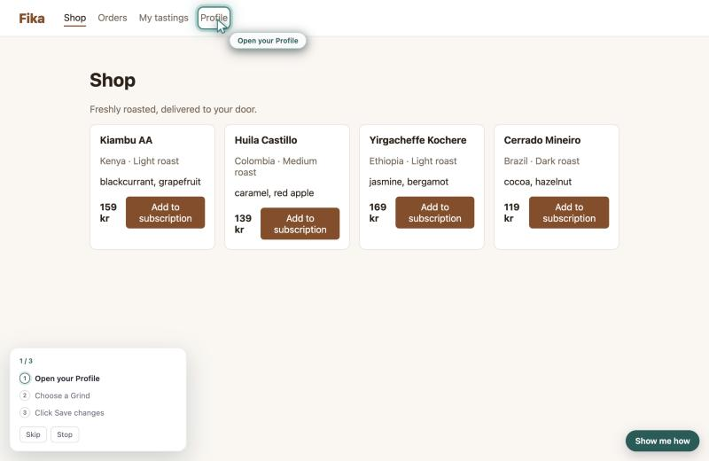
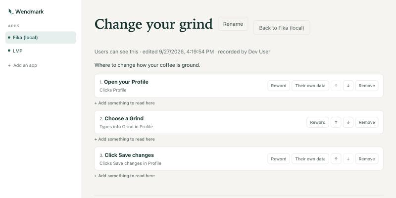

<p align="center">
  <picture>
    <source media="(prefers-color-scheme: dark)" srcset="docs/brand/logo/png/wendmark-horizontal-reversed@2x.png">
    
  </picture>
</p>

<p align="center">
  <strong>Show people how to use your app, without doing it for them.</strong>
</p>

<p align="center">
  <a href="LICENSING.md"></a>
  <a href=".github/workflows/ci.yml"></a>
  
</p>

---

Record a process once. Everyone else replays it as guidance: a teaching cursor
glides to the next thing to click, a panel shows where they are, and **the
person clicks it themselves**.

<p align="center">
  
</p>

## Why another one of these

Most onboarding tools are built to drive. They click, they fill, they submit —
and the user ends up somewhere they do not know how they got to. Wendmark
takes the opposite position, and it is not a preference but a constraint the
codebase enforces:

> **Wendmark guides. It never acts.**
>
> No synthetic clicks. No setting values. No submitting forms. No navigating on
> someone's behalf. Overlays are `pointer-events: none`, listeners are passive
> and capture-phase and never call `preventDefault`. A step advances because
> the person did the thing.

Two consequences fall out of that, and both are the point:

**Nobody is ever stuck in a tour.** The guidance sits beside the application
rather than in front of it. Click something else, go to another page, ignore
it — the app behaves exactly as it does without Wendmark.

**It teaches rather than performs.** Somebody who has been guided through
refunding an order has refunded an order. They can do it again next week.

## What it never records

The recorder reads structure and the labels an application's own designers
wrote — roles, accessible names, test ids, selectors. It does not read
**anything anyone types**: not `.value`, not the text content of a field, not
`contenteditable`, not keystrokes. Password, email and payment fields get no
special case, because there is no case to make.

Three things hold that up, and all three are things that _do not happen_: the
recorder never reaches for a value, a test fails if anything touches the value
getter, and the schema rejects unknown keys server-side. There are no
screenshots and no session replay —
[we turned those down on purpose](docs/decisions/step-snapshots.md).

[docs/security.md](docs/security.md) is the full trust model, including what it
does **not** protect.

## How it works

1. **Record.** From the portal, open your own app and click through the
   process. Wendmark writes down what you touched, never what you typed.
2. **Edit.** Reword each step, reorder, drop the stray clicks, add a note.
   Mark the steps that point at _your own data_ so they are found by shape
   rather than by name in everybody else's account.
3. **Publish.** Publishing freezes a version. Editing the draft afterwards
   never disturbs someone who is mid-process.
4. **Use.** Your users find it in the launcher, or your own help menu calls
   `Wendmark.start(id)`.

<p align="center">
  
</p>

## Status

Early, and honest about it: **not yet released or versioned**, and the API may
still move. That said, the whole path works end to end — record, edit, publish,
target, play, resume — and it is covered by about 900 tests.

| Working                                                           | Not yet                                                                                             |
| ----------------------------------------------------------------- | --------------------------------------------------------------------------------------------------- |
| Recording from inside your own app, paired through the portal     | [Problem reports](https://github.com/Wendmark/wendmark/issues/47) — users retracing what went wrong |
| Editing, reordering, rewording, publishing with frozen versions   | A browser extension, for apps that cannot add a script tag                                          |
| URL targeting, listed/hidden processes, pause and restore         | Analytics, flow-health checks, multi-team                                                           |
| The launcher, progress that survives a reload, shadow DOM support | A hosted service                                                                                    |
| Email-and-password sign-in, optional OIDC single sign-on          |                                                                                                     |
| Self-hosting with Docker Compose                                  |                                                                                                     |

## Try it

Requirements: **Node 22** (see `.nvmrc`), **pnpm 9**, and Docker for the
database.

```bash
corepack enable
pnpm install
pnpm bootstrap
pnpm dev
```

`pnpm bootstrap` starts Postgres, writes `apps/portal/.env` with a generated
`AUTH_SECRET`, applies the migrations and seeds an example organization, app
and process. Run it as often as you like: it never overwrites an existing
`.env`, and the migration and seed are both idempotent. Already have a
Postgres? Copy `apps/portal/.env.example`, point `DATABASE_URL` at it, and
`pnpm bootstrap` leaves your database alone and does the rest.

Then open:

- **Portal** — http://localhost:3100, sign in as `dev@example.com` with the
  password the seed printed
- **Fika** — http://localhost:5174, a pretend coffee-subscription app to try
  guidance against

A real installation does not use the seed. An empty database sends you to
**/setup** to create your organization and its first administrator, and that
screen closes for good once any user exists.

## Using it in your own app

Add an app in the portal, then paste the tag it gives you:

```html
<script src="https://your-portal.example.com/snippet.js" data-app="wm_…"></script>
```

That is the whole integration. The snippet is **12.6 KB gzipped** against a
30 KB budget enforced in CI, renders everything inside a shadow root with
`:host { all: initial }`, exposes exactly one global, and uses no framework —
so it cannot restyle your pages and your pages cannot restyle it.

Wendmark adds nothing to your interface unless you ask. The launcher button is
**off by default**; call `Wendmark.openLauncher()` from your own help menu, or
turn it on in the portal and name it whatever suits your product.

## Self-hosting

```bash
cp .env.prod.example .env.prod          # three values to fill in
docker compose -f docker-compose.prod.yml --env-file .env.prod up -d
```

[docs/deploying.md](docs/deploying.md) covers the settings, CSP for customer
apps, key rotation, what is stored and upgrading.

## Documentation

|                                                |                                                                       |
| ---------------------------------------------- | --------------------------------------------------------------------- |
| [How it is built](docs/architecture/README.md) | Five walkthroughs: the portal's shape, auth, apps, author mode, flows |
| [Decisions](docs/decisions)                    | Why things are the way they are — including the ones we turned down   |
| [Trust model](docs/security.md)                | By attacker, with the gaps named                                      |
| [Deploying](docs/deploying.md)                 | Running it somewhere other than a laptop                              |
| [Authoring processes](docs/authoring-flows.md) | Writing a good one                                                    |
| [Contributing](CONTRIBUTING.md)                | Setup, the rules that are not negotiable, DCO                         |

## Repository layout

```
packages/
  core/        @wendmark/core     Types and zod schemas. No DOM, network or Node.
  dom/         @wendmark/dom      Element fingerprints and the resolver.
  snippet/     @wendmark/snippet  Player, recorder and UI. One IIFE, 30 KB budget.
apps/
  portal/      @wendmark/portal      Next.js portal. Depends on core only.
  playground/  @wendmark/playground  "Fika", a demo app to try guidance against.
docs/          Architecture, decisions, security, brand
legacy/        An early Chrome extension prototype. Reference only — see docs/legacy-notes.md
```

Which package may import which is a table, and the table is
[enforced by ESLint](eslint.config.js) with a test proving every rule fires.
[CLAUDE.md](CLAUDE.md) is the long version of the house rules.

## Contributing

Issues are welcome. So are pull requests, with one request: for anything
beyond a small fix, **open an issue first** — it is kinder than having work
rejected on direction after you have written it.

There is **no contributor licence agreement**, and none is planned. We ask for
a [DCO](https://developercertificate.org/) sign-off (`git commit -s`), which
means what you contribute cannot quietly be made proprietary later.

[CONTRIBUTING.md](CONTRIBUTING.md) has the detail. Found a vulnerability?
Please don't open a public issue — [SECURITY.md](SECURITY.md) says what to do.

## Licence

Two licences, chosen for where each part ends up running.

| Path                                                | Licence        |
| --------------------------------------------------- | -------------- |
| `packages/core`, `packages/dom`, `packages/snippet` | **Apache-2.0** |
| `apps/portal`, `apps/playground`, everything else   | **AGPL-3.0**   |

The snippet runs inside other companies' products, so it carries a permissive
licence: paste the script tag and nothing is asked of your own source. The
portal is the part someone could host as a service, so it carries the AGPL —
run a modified copy for other people and you publish the modifications.

[LICENSING.md](LICENSING.md) explains what that means in practice.
